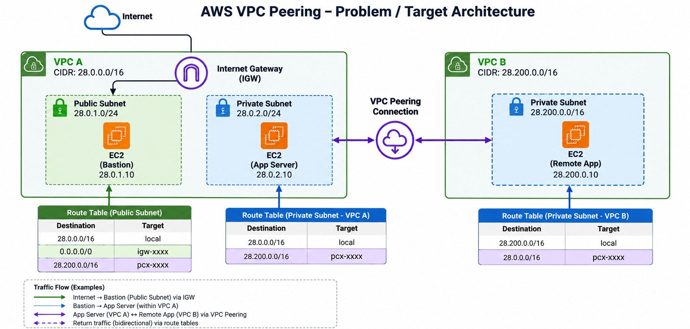
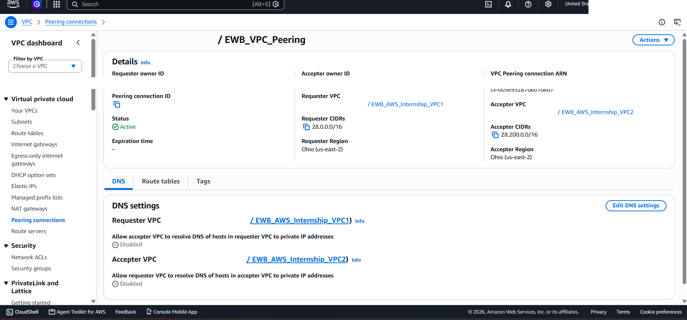
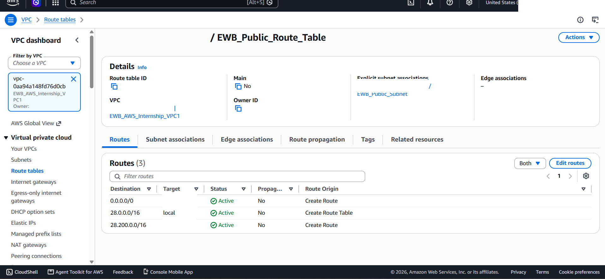
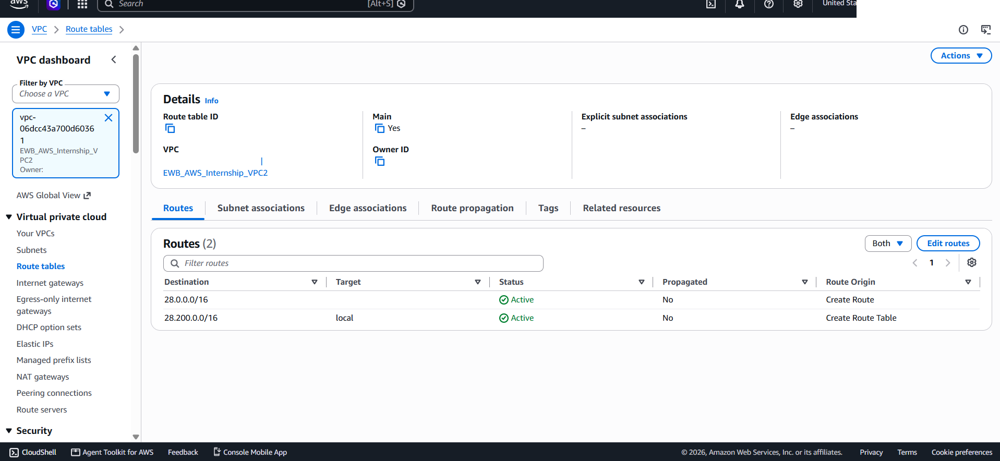
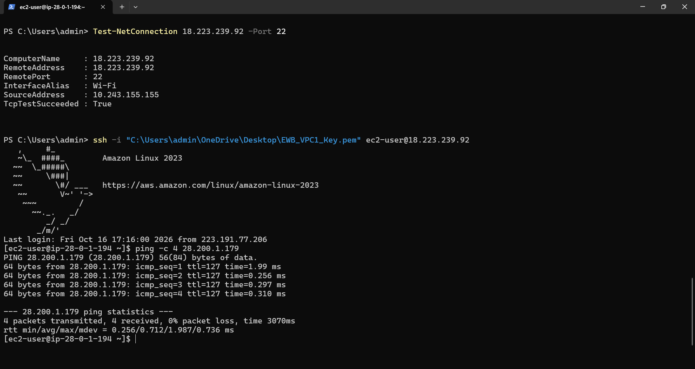
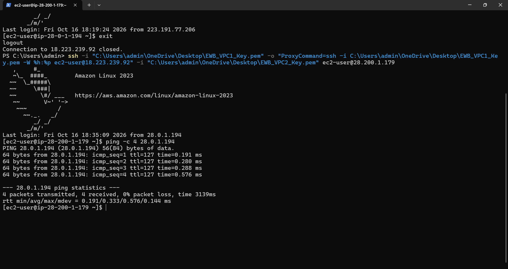
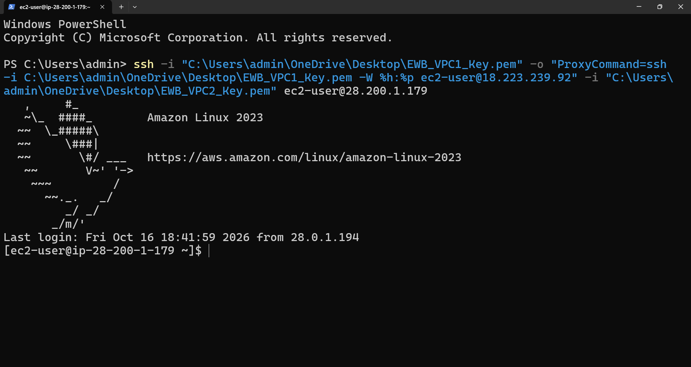
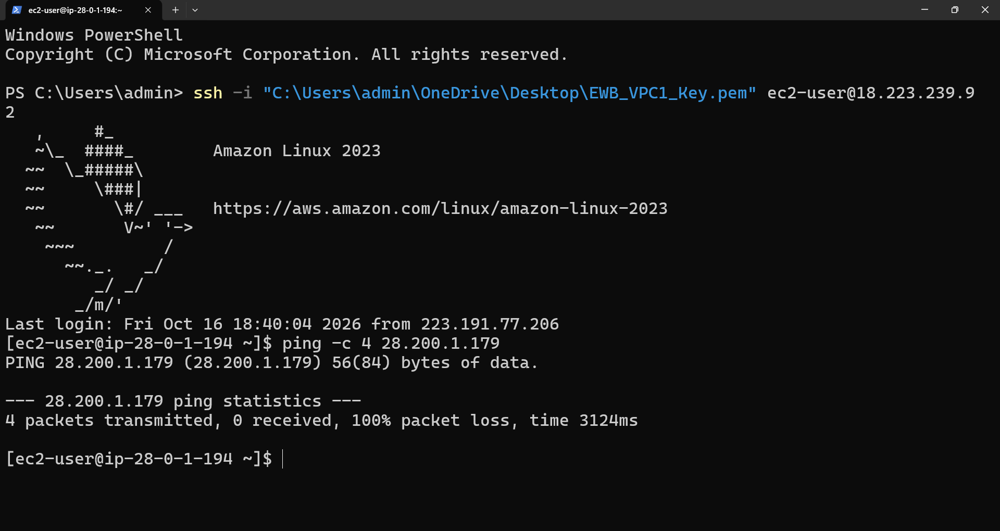
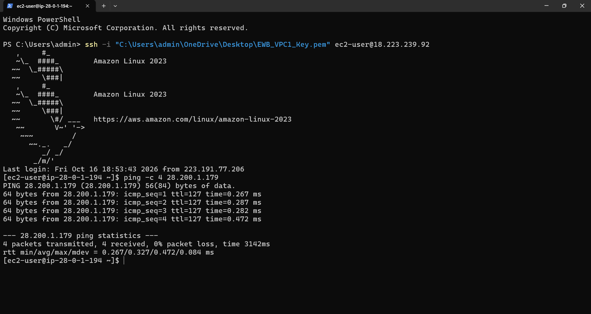

# AWS VPC Peering — Cross-VPC Connectivity

A hands-on AWS networking project demonstrating connectivity between two Virtual Private Clouds (VPCs) using **VPC Peering**, route table configuration, security group rules, and EC2 connectivity testing.

The project explores how resources in separate VPCs can communicate using their VPC-assigned IP addresses through a peering connection.

**Project:** EWB AWS Internship  
**Cloud Platform:** Amazon Web Services (AWS)  
**Region:** US East (Ohio) — `us-east-2`  
**Services:** Amazon VPC, VPC Peering, Amazon EC2, Route Tables, Security Groups

---

## Architecture

The following architecture diagram is included in the project repository.



[View full-size architecture diagram](02_Architecture/AWS_VPC_Peering_Target_Architecture.png)

[Read the detailed project report (PDF)](01_Report/AWS-VPC-Peering-Report.pdf)

## Project Overview

Amazon VPC provides isolated virtual networks for deploying AWS resources. By default, resources in separate VPCs cannot communicate directly.

This project demonstrates how to establish connectivity between two VPCs using an AWS VPC Peering connection.

The lab involved:

- Creating two VPCs with separate IPv4 CIDR blocks.
- Deploying EC2 instances in the VPCs.
- Establishing a VPC Peering connection.
- Configuring route tables on both sides.
- Configuring security groups for SSH and ICMP traffic.
- Establishing SSH access to EC2 instances.
- Testing connectivity between instances using their VPC-assigned IP addresses.
- Troubleshooting failed connectivity and verifying successful communication.

## Objectives

- Understand AWS VPC architecture and CIDR addressing.
- Configure connectivity between two separate VPCs.
- Create and activate a VPC Peering connection.
- Configure routes for communication between the VPC networks.
- Understand security group rules for SSH and ICMP.
- Access EC2 instances using SSH.
- Explore SSH proxy-based access to an instance without a public IPv4 address.
- Validate network connectivity and document troubleshooting evidence.

## Network Configuration

### VPC 1 — EWB_AWS_Internship_VPC1

| Configuration | Value |
|---|---|
| VPC name | `EWB_AWS_Internship_VPC1` |
| IPv4 CIDR | `28.0.0.0/16` |
| EC2 instance | `EWB_VPC1_EC2` |
| Security group | `EWB_VPC1_EC2_SG` |
| Route table | `EWB_Public_Route_Table` |

### VPC 2 — EWB_AWS_Internship_VPC2

| Configuration | Value |
|---|---|
| VPC name | `EWB_AWS_Internship_VPC2` |
| IPv4 CIDR | `28.200.0.0/16` |
| EC2 instance | `EWB_VPC2_EC2` |
| Security group | `EWB_VPC2_EC2_SG` |
| Public IPv4 | None shown for the instance in the project evidence |

### VPC Peering Connection

| Configuration | Value |
|---|---|
| Connection name | `EWB_VPC_Peering` |
| Region | `us-east-2` |
| Observed status | Active |

The project evidence records an active peering connection between the two VPCs.

### CIDR Addressing Note

The lab uses `28.0.0.0/16` and `28.200.0.0/16`. These ranges are outside the private IPv4 ranges specified by RFC 1918.

AWS supports publicly routable CIDR blocks for VPCs, but recommends RFC 1918 address ranges for new VPC configurations. The original lab ranges are retained here to accurately document the completed exercise.

For future environments, use suitable, non-overlapping RFC 1918 ranges such as:

- `10.0.0.0/16`
- `172.16.0.0/16`
- `192.168.0.0/20`

Choose ranges after checking for conflicts with other connected networks.

## Implementation

### Step 1 — Create and Configure VPCs

Created two separate VPCs in the `us-east-2` region with distinct IPv4 CIDR blocks.

- VPC 1: `28.0.0.0/16`
- VPC 2: `28.200.0.0/16`

The networks were configured with separate subnets and EC2 resources for connectivity testing.

### Step 2 — Deploy EC2 Instances

Created the EC2 instances used in the lab:

- `EWB_VPC1_EC2`
- `EWB_VPC2_EC2`

The first instance had a public IPv4 address during the SSH testing phase. The second instance did not have a public IPv4 address in the supplied evidence.

### Step 3 — Create the VPC Peering Connection

Created a VPC Peering connection named `EWB_VPC_Peering` between the two VPCs.

The connection was established and its status was verified as **Active** in the AWS Management Console.

### Step 4 — Configure Route Tables

Configured routes on both sides so that traffic destined for the other VPC's CIDR block could use the peering connection.

| Route table | Destination | Target |
|---|---|---|
| VPC 1 route table | `28.200.0.0/16` | VPC Peering connection |
| VPC 2 route table | `28.0.0.0/16` | VPC Peering connection |

The route tables also retain their respective local routes. The VPC 1 public route table includes an internet gateway default route as shown in the evidence.

**Important:** Creating a peering connection alone does not configure routing. Appropriate routes must be added to the route tables used by the communicating subnets.

### Step 5 — Configure Security Groups

Configured the EC2 security groups to permit the traffic required for testing.

The project evidence includes:

- SSH access using TCP port `22`.
- ICMP rules for ping-based connectivity testing.
- A restricted SSH source using a single IPv4 address with a `/32` mask in one of the captured rules.

Security group rules should follow the principle of least privilege. Restrict SSH access to trusted sources and avoid unnecessarily exposing management ports to the internet.

### Step 6 — Establish SSH Connectivity

Used Windows PowerShell and SSH to access the first EC2 instance.

A proxy-based SSH connection was then used to access the second instance through the first instance.

This provided a way to reach the second EC2 instance without assigning it a public IPv4 address.

Private SSH keys should remain outside the repository and must never be committed to GitHub.

## Connectivity Testing and Results

Connectivity was tested using PowerShell and Linux terminal commands.

| Test | Observed result |
|---|---|
| TCP connectivity to the first EC2 instance on port 22 | Successful |
| SSH access to the first EC2 instance | Successful |
| SSH proxy access to the second EC2 instance | Successful |
| Ping from VPC 1 instance to VPC 2 instance | Successful in later test |
| Ping from VPC 2 instance to VPC 1 instance | Successful |
| Initial ICMP connectivity test | Failed |
| ICMP connectivity after troubleshooting | Successful |

The evidence includes successful forward and reverse ping tests, along with an earlier failed ICMP test and a subsequent recovery test.

A successful ping confirms ICMP reachability at the time of testing. It does not independently verify every application protocol or service.

## Evidence Gallery

### 1. VPC Peering Connection



### 2. Route Table Configuration

**VPC 1 route table**



**VPC 2 route table**



### 3. Connectivity Verification

**Forward-direction ping**



**Reverse-direction ping**



### 4. SSH Access



### 5. Troubleshooting and Recovery

**Controlled ICMP failure**



**Successful connectivity after troubleshooting**



## Complete Evidence Index

All 17 evidence screenshots are maintained in `03_Evidence_Screenshots/`.

| No. | Evidence file | Description |
|---:|---|---|
| 01 | [01_VPC_Peering_Active.png](03_Evidence_Screenshots/01_VPC_Peering_Active.png) | Active VPC Peering connection |
| 02 | [02_VPC1_Route_Table.png](03_Evidence_Screenshots/02_VPC1_Route_Table.png) | VPC 1 route table |
| 03 | [03_VPC2_Route_Table.png](03_Evidence_Screenshots/03_VPC2_Route_Table.png) | VPC 2 route table |
| 04 | [04_Third_Route_Table.png](03_Evidence_Screenshots/04_Third_Route_Table.png) | Additional route table evidence |
| 05 | [05_VPC1_Security_Group.png](03_Evidence_Screenshots/05_VPC1_Security_Group.png) | VPC 1 security group |
| 06 | [06_VPC2_Security_Group.png](03_Evidence_Screenshots/06_VPC2_Security_Group.png) | VPC 2 security group |
| 07 | [07_VPC2_Security_Group_SSH_Rule.png](03_Evidence_Screenshots/07_VPC2_Security_Group_SSH_Rule.png) | VPC 2 SSH rule |
| 08 | [08_EC2_Resource_Details_VPC1.png](03_Evidence_Screenshots/08_EC2_Resource_Details_VPC1.png) | VPC 1 EC2 resource details |
| 09 | [09_EC2_Resource_Details_VPC2.png](03_Evidence_Screenshots/09_EC2_Resource_Details_VPC2.png) | VPC 2 EC2 resource details |
| 10 | [10_Forward_Ping_Success.png](03_Evidence_Screenshots/10_Forward_Ping_Success.png) | Forward ICMP test |
| 11 | [11_Reverse_Ping_Success.png](03_Evidence_Screenshots/11_Reverse_Ping_Success.png) | Reverse ICMP test |
| 12 | [12_Private_SSH_Access.png](03_Evidence_Screenshots/12_Private_SSH_Access.png) | Private SSH access |
| 13 | [13_Controlled_ICMP_Failure.png](03_Evidence_Screenshots/13_Controlled_ICMP_Failure.png) | Initial ICMP failure |
| 14 | [14_Available_Before_Cleanup.png](03_Evidence_Screenshots/14_Available_Before_Cleanup.png) | EC2 resources before cleanup |
| 15 | [15_Cleanup_Evidence.png](03_Evidence_Screenshots/15_Cleanup_Evidence.png) | Manually redacted cleanup evidence |
| 16 | [16_ICMP_Recovery_Success.png](03_Evidence_Screenshots/16_ICMP_Recovery_Success.png) | Successful ICMP test after troubleshooting |
| 17 | [17_Architecture_and_Resource_Inventory.png](03_Evidence_Screenshots/17_Architecture_and_Resource_Inventory.png) | Architecture and resource inventory |

## Troubleshooting Notes

When connectivity between the VPCs does not work, verify the following:

1. The VPC Peering connection is active.
2. The VPC CIDR blocks do not overlap.
3. Both relevant route tables contain routes to the peer VPC.
4. Security groups permit the required source, protocol, and port.
5. Network ACLs allow the required inbound and outbound traffic.
6. The destination instance and its operating system permit the test traffic.
7. SSH usernames, private key permissions, and proxy settings are correct.

A failed ping does not necessarily indicate a broken peering connection. ICMP traffic may be blocked by a security group, network ACL, or operating-system firewall.

## Key Learning Outcomes

Through this project, I practised:

- AWS VPC architecture and IPv4 CIDR planning.
- VPC Peering connection configuration.
- Route table configuration for communication between VPCs.
- EC2 instance access using SSH.
- Proxy-based SSH connectivity.
- Security group configuration for SSH and ICMP.
- Connectivity testing using PowerShell and Linux terminal commands.
- Troubleshooting network reachability.
- Documenting cloud infrastructure and implementation evidence.

## Security Considerations

- Keep SSH private keys and credentials outside the repository.
- Restrict SSH inbound rules to trusted source addresses.
- Permit only the protocols and ports required for the task.
- Review security group and network ACL rules before deployment.
- Check screenshots for AWS account IDs and other sensitive information before sharing them publicly.
- The cleanup evidence image is identified as manually redacted.

## Limitations and Future Improvements

This project was created as a hands-on learning exercise and is not intended as a production-ready network design.

Possible improvements include:

- Use non-overlapping RFC 1918 CIDR ranges for future deployments.
- Use AWS Systems Manager Session Manager for instance access.
- Apply more restrictive security group rules.
- Introduce centralized logging and network monitoring.
- Automate resource provisioning with AWS CloudFormation or Terraform.
- Add automated connectivity validation.

## Repository Structure

```text
EWB-AWS-Internship/
│
├── 01_Report/
│   └── AWS-VPC-Peering-Report.pdf
│
├── 02_Architecture/
│   └── AWS_VPC_Peering_Target_Architecture.png
│
├── 03_Evidence_Screenshots/
│   ├── 01_VPC_Peering_Active.png
│   ├── 02_VPC1_Route_Table.png
│   ├── 03_VPC2_Route_Table.png
│   ├── 04_Third_Route_Table.png
│   ├── 05_VPC1_Security_Group.png
│   ├── 06_VPC2_Security_Group.png
│   ├── 07_VPC2_Security_Group_SSH_Rule.png
│   ├── 08_EC2_Resource_Details_VPC1.png
│   ├── 09_EC2_Resource_Details_VPC2.png
│   ├── 10_Forward_Ping_Success.png
│   ├── 11_Reverse_Ping_Success.png
│   ├── 12_Private_SSH_Access.png
│   ├── 13_Controlled_ICMP_Failure.png
│   ├── 14_Available_Before_Cleanup.png
│   ├── 15_Cleanup_Evidence.png
│   ├── 16_ICMP_Recovery_Success.png
│   └── 17_Architecture_and_Resource_Inventory.png
│
└── README.md
```

## Conclusion

This project provided practical experience in connecting two separate AWS VPCs using VPC Peering.

By configuring route tables, security groups, EC2 access, and connectivity tests, I gained hands-on experience with AWS networking fundamentals and cloud infrastructure troubleshooting.

The project strengthened my understanding of VPC architecture, routing, access control, SSH connectivity, and network validation.

## References

- [Amazon VPC CIDR blocks](https://docs.aws.amazon.com/vpc/latest/userguide/vpc-cidr-blocks.html)
- [How VPC peering connections work](https://docs.aws.amazon.com/vpc/latest/peering/vpc-peering-basics.html)
- [VPC peering connection routing](https://docs.aws.amazon.com/vpc/latest/peering/vpc-peering-routing.html)

---

**Project completed as part of the EWB AWS Internship.**
